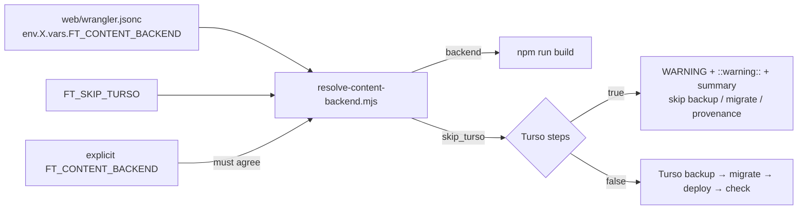

# Content backend switch (Turso ↔ Cloudflare D1)

Temporary fallback added 23 November 2026 after the Turso starter account hit its
syncs quota and blocked reads on both production and staging EmDash databases.

## How the switch works

The Worker is **not** switched at request time only. EmDash's official D1 adapter
is selected at **Astro build time** by `FT_CONTENT_BACKEND`:

| Value | Adapter | Required bindings / secrets |
| --- | --- | --- |
| `turso` (default) | Existing request-scoped libsql shim | `TURSO_DATABASE_URL`, `TURSO_AUTH_TOKEN` secrets |
| `d1` | `d1({ binding: "EMDASH", session: "disabled" })` from `@emdash-cms/cloudflare` | wrangler `d1_databases` binding named `EMDASH` |

Set the same value in:

1. The build environment (`FT_CONTENT_BACKEND=d1` when running the staging/production deploy script).
2. `web/wrangler.jsonc` `env.<name>.vars.FT_CONTENT_BACKEND` so the deployed Worker records which backend it was built for.

Media stays on R2 (`MEDIA`). The scheduler / subscriptions Workers stay on Turso
and must not be pointed at these D1 databases.

## Current fallback databases (23 Nov 2026)

- Staging D1: `freedomtimes-emdash-staging-fallback-20261123` (`ba03720b-f6f8-4ab1-b3cf-c2809b4bb0bf`, WEUR), hydrated from `emdash-staging-20261122-192351.db`.
- Production D1: `freedomtimes-emdash-production-fallback-20261123` (`ece69b46-eacd-4ce5-9923-68185cfcfb48`, WEUR), hydrated from `emdash-production-20261122-192325.db`. Production Worker deploy of this binding is a separate, explicit step.

Hydrate with bound parameters (do **not** `wrangler d1 execute --file` a raw `sqlite3 .dump` — statements over 100 KB will fail):

```
node web/scripts/hydrate-d1-from-sqlite.mjs --sqlite .release/backups/<file>.db --database-id <uuid>
```

The Terraform Cloudflare API token used for Workers deploy does not include
`d1:write`. Creating and hydrating D1 is done with a local `wrangler login`
(OAuth has `d1:write`).

## Single source of truth and the Turso bypass

`web/wrangler.jsonc` `env.<name>.vars.FT_CONTENT_BACKEND` decides the backend for each
environment. `web/scripts/resolve-content-backend.mjs` (logic in
`web/scripts/lib/content-backend.mjs`, tests in `web/scripts/test-content-backend.mts`) reads it,
and the deploy scripts and CI export it as `FT_CONTENT_BACKEND` before `npm run build`, so the
bundle always matches the Worker. An explicit `FT_CONTENT_BACKEND` that disagrees with wrangler
fails the run before anything is backed up, built or deployed.

Turso steps are **bypassed** when either:

| Trigger | Scope |
| --- | --- |
| The env's wrangler backend is `d1` | EmDash content DB steps: Turso backup / `staging-rollback-*` / `prod-rollback-*` branch, `emdash migrate` apply + `--check`, production Turso host provenance (#142/#148), `-UseFreshTursoCheckpoint` |
| `FT_SKIP_TURSO=1` (env var locally; **repo variable** `FT_SKIP_TURSO` in GitHub Actions) | All of the above, plus the scheduler / subscriptions / tips SQL deploys in `terraform-*.yml` |

A bypass is never silent:

- console: a yellow `WARNING: TURSO STEPS BYPASSED (<env>) …` banner;
- GitHub Actions: a `::warning title=TURSO STEPS BYPASSED (<env>)::…` annotation on the run;
- GitHub Actions: a `⚠️ TURSO STEPS BYPASSED` block in the job summary, with the reason and the
  safety net (D1 Time Travel + the admin export).



## Staging and production deploys while Turso is blocked

No special flags: the wrangler backend (`d1`) already bypasses the Turso steps, locally and in CI
(`deploy-worker.yml` staging on every PR push, production on merge to `main`).

```
pwsh ./scripts/deploy-staging-local.ps1 -WorkerOnly
pwsh ./scripts/deploy-production-local.ps1 -WorkerOnly -AllowProduction
```

`-SkipTursoBackup` still works as before. Terraform no longer strips the D1 binding:
`modules/cloudflare_holding_page` keeps `d1` bindings (Wrangler-owned, like KV and R2), and the
D1 databases can be adopted into Terraform state (below).

The web Worker deploy covers only the web Worker. Leave the scheduler / subscriptions Workers
on Turso (do not retarget them at D1). Rollback: `npx wrangler rollback 6926c482-02f8-4cdb-a379-e8de04f5c6c1 --env production --config wrangler.jsonc`.


## Swap back to Turso

1. Confirm Turso reads are unblocked (quota reset or plan change). Do not change billing from this runbook.
2. Set `FT_CONTENT_BACKEND` to `turso` in `web/wrangler.jsonc` `env.<name>.vars` (or remove the var so the default applies). That one change turns every Turso step back on (backup, migrate, provenance); unset the `FT_SKIP_TURSO` repo variable if it was set.
3. Rebuild and deploy the same Worker. The `EMDASH` D1 binding can stay unused.
4. Or, without a new build, roll back the Worker:
   - Staging previous version: `cb64d297-b665-4bce-8d30-bacd0d87b596` (created 22 Nov 2026, 20:00 UTC / 20:00 Europe/London).
     `npx wrangler rollback cb64d297-b665-4bce-8d30-bacd0d87b596 --env staging --config wrangler.jsonc`
   - Production previous version: `6926c482-02f8-4cdb-a379-e8de04f5c6c1` (created 16 Nov 2026, 08:38 UTC / 08:38 Europe/London).
     `npx wrangler rollback 6926c482-02f8-4cdb-a379-e8de04f5c6c1 --env production --config wrangler.jsonc`

Content written only to D1 during the outage will not be on Turso after swap-back.
Treat the D1 window as read-mostly. Leave the scheduler on Turso.

## D1 databases in Terraform

`infra/terraform/environments/<env>/d1.tf` adopts each fallback database with an `import` block
(no create, no replace; `prevent_destroy`). It is gated by `manage_emdash_d1_fallback`
(default `false`) because the Terraform Cloudflare API token (`TF_VAR_CLOUDFLARE_API_TOKEN`) has no
D1 permission, so a plan that reads the database would fail. To adopt:

1. Add **Account → D1 → Edit** to that token (Cloudflare dashboard → API Tokens).
2. Set the GitHub repo variable `TF_VAR_MANAGE_EMDASH_D1_FALLBACK=true` (locally:
   `$env:TF_VAR_manage_emdash_d1_fallback = "true"`).
3. Plan: expect `1 to import` for `cloudflare_d1_database.emdash_fallback["emdash"]`, nothing destroyed.

The `EMDASH` binding itself stays in `web/wrangler.jsonc` (one owner); Terraform keeps it on apply.

## Test the switch by config (no deploy required for the unit of choice)

`FT_CONTENT_BACKEND=turso` (default) keeps `emdashTursoDatabase`. `FT_CONTENT_BACKEND=d1`
selects `emdashD1Database`. Any other value fails the build.

## D1 import notes

Cloudflare D1 leaves `PRAGMA foreign_keys` on (the pragma cannot be turned off,
even in a multi-statement or batch request). The hydrator therefore strips
`FOREIGN KEY` clauses from `CREATE TABLE` and loads rows with bound parameters.
Unique and primary-key constraints are kept. FTS5 virtual tables store their
own content (no `content=` table), so a `rebuild` of an empty virtual table
stays empty. The hydrator copies the source FTS rows with bound parameters;
shadow tables from the export are not replayed. Do not `wrangler d1 execute --file` a
raw `sqlite3 .dump` (100 KB statement limit).


## Writes on D1 and swap-back

EmDash 1.5.0 has no site-wide read-only mode (the official `d1()` adapter
only configures `binding`, `session`, `bookmarkCookie`, and `coalesce`.
"Read-only" in EmDash refers to per-entry edit locks, individual GET APIs,
or the CLI opening a SQLite file with `readOnly: true`). This fallback
therefore allows writes to the D1 database.

Any content, media metadata, or CMS changes written to D1 during the outage
**must be copied back to Turso before swap-back**. A Turso rebuild/deploy or
`wrangler rollback` will serve the pre-outage Turso database and will not
include D1-only writes. Do not swap back until that copy is done and verified,
or accept losing those changes.

## Admin SQLite export

`/admin/content-export` (admin role only; tile "Content database export" on `/admin`) downloads the
**content database the running Worker is using**: D1 `EMDASH` on production and staging today, Turso
after the swap back. Each environment exports its own database, because the route uses the Worker's
own `getDb()`. The API is `GET /api/admin/content-export`; it checks the admin role before it opens the
database.

- **Format:** a gzip'd SQLite SQL dump (`freedomtimes-<env>-content-<backend>-<UTC stamp>.sql.gz`;
  add `?format=sql` for plain text). It is streamed table by table, 200 rows per query, so a 45 MB
  database never has to fit in Worker memory. A binary `.db` cannot be built inside a Worker.
- **Contents:** every table, index, view, trigger and FTS5 table with its rows. FTS shadow tables
  and D1/libSQL internals (`_cf_*`, `sqlite_*`, `libsql_*`) are left out; they rebuild themselves.
- **Integrity:** the file ends with per-table row counts and `-- end of export`. A download cut
  short has no trailer, and the restore script refuses it.
- **Restore to a `.db`:**

  ```powershell
  cd web
  node scripts/sqlite-from-content-export.mjs .\freedomtimes-production-content-d1-....sql.gz .\restored.db
  ```

  This runs `PRAGMA integrity_check` and prints the row counts.
- **Restore into Turso or D1 (format 2, portable):** the same file loads unchanged into a NEW, EMPTY
  database of either backend:

  ```bash
  turso db shell <db-name-or-url> < freedomtimes-...sql            # gz: gunzip -c file.sql.gz | turso db shell ...
  npx wrangler d1 execute <DB> --file freedomtimes-...sql          # wrangler needs the plain .sql
  ```

  Format 2 (header `-- format: 2`) has no `BEGIN TRANSACTION`/`COMMIT` (D1 rejects them and runs
  the file in one transaction itself), no statement over 90,000 bytes (D1's limit is 100,000; long
  rows are an INSERT plus `UPDATE ... SET col = col || '…'` appends), parent tables before child
  tables plus `PRAGMA defer_foreign_keys=ON` (D1 always enforces foreign keys), and string values
  that contain `BEGIN TRANSACTION` or `COMMIT;` written as `'…BEGIN' || ' TRANSACTION…'` (wrangler
  strips those tokens from the whole file, string literals included). With `turso db shell` or
  `sqlite3` a failed restore leaves a partial database: delete it and restore into a new one.
- **Interop gate:** `npm run test:content-export-restore` restores a synthetic export (.sql and
  .sql.gz) into a local `turso dev` and a local D1 (`wrangler d1 execute --local`) and compares every
  row with the source. CI runs it on every PR (`ci-guards.yml`, job *Content export restores into
  local Turso + local D1*) with `FT_REQUIRE_RESTORE_TARGETS=1`; locally it skips with a WARNING when
  turso/sqld are missing. Never Turso Cloud, never `--remote`, no credentials.
- **Check a real download:** `npm run content-export:verify-restore -- <file.sql[.gz]> [...]` does the
  same for a real export (local only; prints counts, never rows).
- **Format 1 files** (downloaded before this fix, e.g. the 23 Nov staging exports) restore into
  Turso/sqlite3 as they are, but `wrangler d1 execute` rejects them (`statement too long:
  SQLITE_TOOBIG`; remote D1 also rejects their `BEGIN TRANSACTION`). Convert first:
  `npm run content-export:upgrade -- old.sql[.gz] new.sql` (same rows, format 2).
- **Audit:** each export logs `[admin-content-export] started/completed` with the admin's name and
  the cf-ray. The response is `Cache-Control: no-store, private`.
- The file contains **private data** (users, sessions, unpublished drafts). Keep it off shared drives.
- Large exports use Worker CPU time. The paid Workers plan (30 s CPU by default) is enough for the
  current database: about 1.3 s locally to dump 40 MB.
